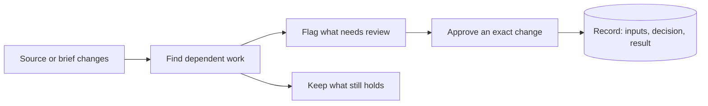

## Hi, I'm Tate 👋

I'm a software builder in Santa Monica. I work on products that take messy context, such as a wardrobe, a brand, a business, or a codebase, and turn it into something coherent and reviewable. Site: tate.socha.vercel.app

## Selected work

<table>
<tr>
<td width="50%" valign="top">

### Volley
**Complete outfits from what you already own.**

Turn your wardrobe and your inspiration into outfits you can actually wear.

`Private beta` · `35 active testers`

**How it works**
- Wardrobe items and inspiration images are embedded and compared by similarity.
- Ownership, category, and availability are enforced in SQL, so suggestions only use what the user has.
- The model proposes outfits. Constraints decide what's valid.

**Stack:** Supabase · Cloudflare · Python · JavaScript · Sentry · PostHog

</td>
<td width="50%" valign="top">

### Onbrand
**Brand context in, cohesive content out.**

Turn a business's brand context into reviewable content packages, so teams spend less time re-explaining the brand and more time creating.

`Private beta` · `Design partner` · `Powered by Carryplane`

**How it works**
- Only approved brand revisions are retrieved as context.
- Each package records which context versions it used.
- Packages go to review before anything is published.

**Stack:** Supabase · Cloudflare · Python · JavaScript · Sentry · PostHog · Fly.io

</td>
</tr>
<tr>
<td width="50%" valign="top">

### The Desk
**Launch together. Stay aligned.**

Start a business through coordinated workstreams (engineering, website, marketing, infrastructure), then keep the work aligned as things change.

`Private beta` · `Powered by Carryplane`

**How it works**
- One versioned business definition feeds every workstream.
- Approvals bind to the exact action, target, and content.
- When the offer or scope changes, affected work is flagged for review and unaffected work is preserved.

**Stack:** Supabase · Cloudflare · Python · JavaScript · Sentry · PostHog · Vercel

</td>
<td width="50%" valign="top">

### Portwell
**Migration prep you can review.**

Prepare for software discontinuations and migrations with evidence-backed, reviewable plans.

`Private beta`

**How it works**
- Captures the upstream notice as a versioned source.
- Maps it to repository exposure, including dependency files and code locations.
- Produces a migration package with evidence links, open questions, and a verification plan.
- Flags what to re-review when guidance or the repository changes.

**Stack:** Supabase · Cloudflare · Python · JavaScript · Sentry · PostHog

</td>
</tr>
</table>

## Shared foundation

| Layer | Used across all four |
|---|---|
| Data and auth | Supabase (Postgres) |
| Edge and delivery | Cloudflare |
| Languages | Python, JavaScript |
| Error monitoring | Sentry |
| Product analytics | PostHog |

Project-specific hosting: **Vercel** for The Desk, **Fly.io** for Onbrand.

## Powered by Carryplane

Carryplane is the internal context and continuity layer behind Onbrand and The Desk. It isn't a standalone product.



| Carryplane records | Why it matters |
|---|---|
| Exact source and context versions | Work can be traced to what it was based on |
| Dependencies between artifacts | Changes show what's affected |
| Decisions and approvals | Reviewers see what was accepted, and when |
| Verification results | "Checked" means a specific check ran |

## Engineering principles

- **AI proposes. People approve.** Models draft, rank, and extract. Authority sits with an approval step.
- **SQL enforces the rules.** Ownership, status, and permissions live in the database, not in a prompt.
- **Evidence over assertion.** Output links back to the inputs it used.
- **Honest status.** Every project shows where it actually is.

<details>
<summary><b>Example: finding work affected by a change</b></summary>

```sql
select a.id, a.kind, a.title
from artifact_consumptions c
join artifacts a on a.id = c.artifact_id
where c.source_object_id = :offer_id
  and c.source_revision_id <> :current_offer_revision
  and a.status <> 'superseded';
```

</details>
